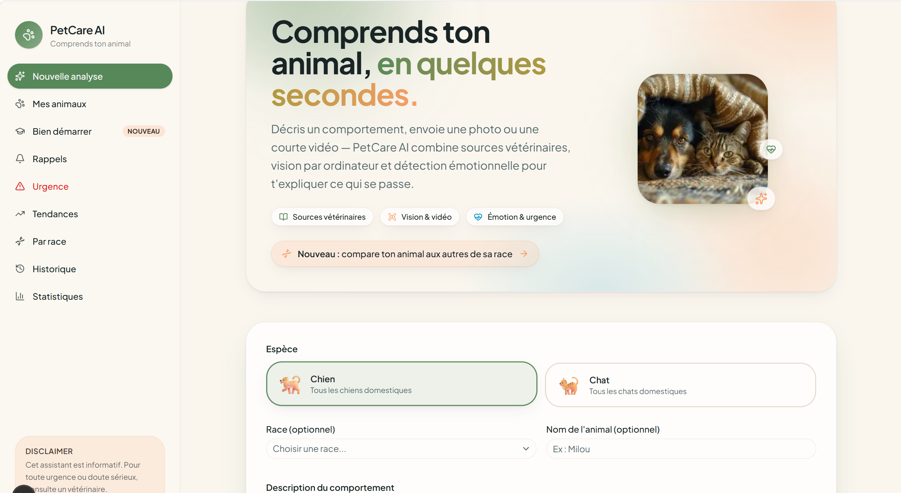
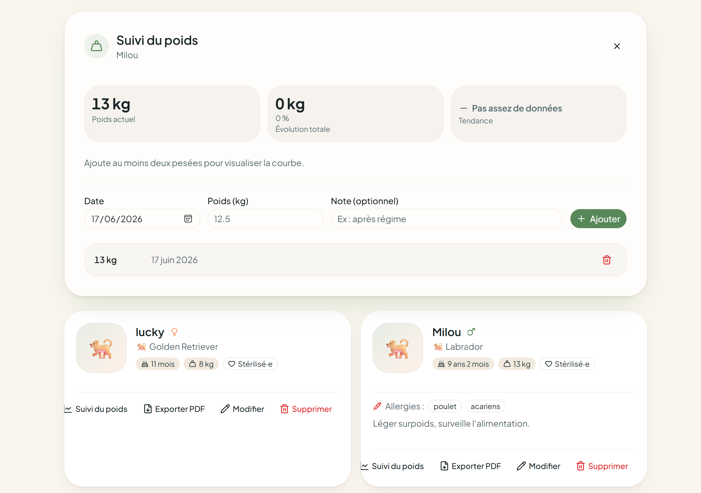
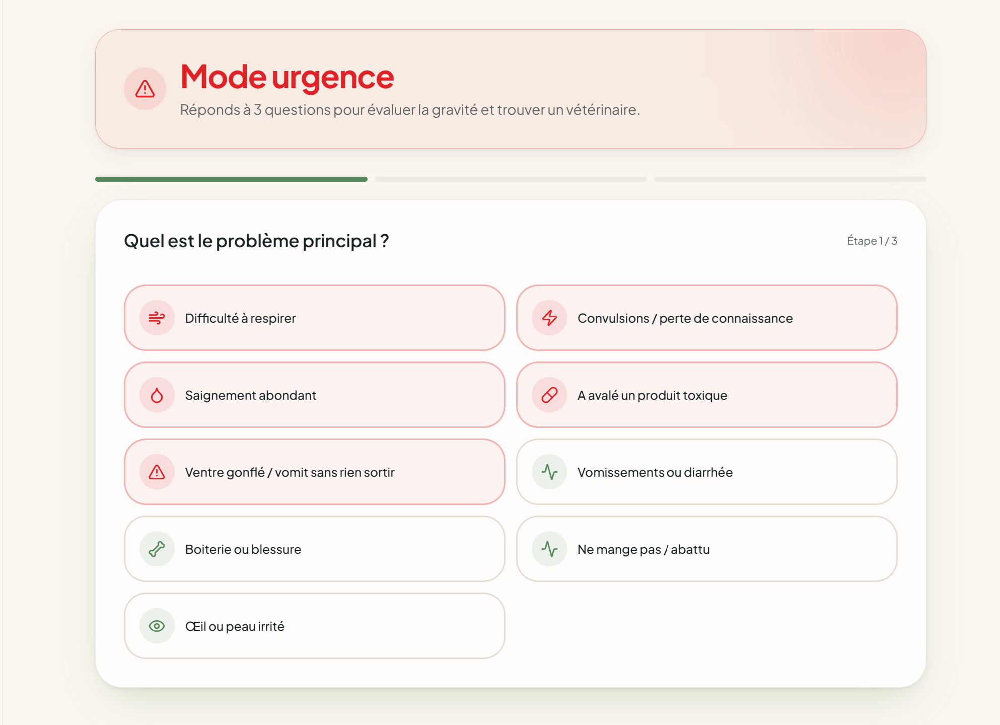

# PetCare AI

🔗 **Démo en ligne : [pet-care-ai-black.vercel.app](https://pet-care-ai-black.vercel.app)**

Une application qui analyse le comportement des animaux de compagnie (chiens et chats) pour aider leurs propriétaires à mieux les comprendre.

On décrit le comportement de son animal (par texte, photo ou courte vidéo) et l'application répond en s'appuyant sur une base de connaissances vétérinaire (RAG). Elle gère aussi un carnet de suivi : fiche santé, poids, rappels de soins et export d'un dossier pour le vétérinaire.

## Captures

Accueil et analyse du comportement :



Carnet de l'animal et suivi du poids :



Mode urgence avec triage en 3 questions :



## Fonctionnalités

- Analyse du comportement par texte, photo ou vidéo (20 secondes maximum)
- Détection de l'émotion et du niveau d'urgence (vert / jaune / orange / rouge)
- Réponses basées sur une base de connaissances vétérinaire (RAG)
- Fiche complète de l'animal : âge, poids, vaccins, allergies, notes
- Suivi du poids avec courbe et alerte en cas de variation anormale
- Calendrier de rappels (vaccins, vermifuges, visites)
- Export du dossier vétérinaire en PDF
- Mode urgence avec triage rapide
- Guide pour les nouveaux propriétaires et comparaison par race

## Architecture

```
Navigateur ──► Frontend Next.js (Vercel) ──► API FastAPI (Docker, Hugging Face Spaces)
                                                 │
                     ┌───────────────────────────┼───────────────────────────┐
                     ▼                           ▼                           ▼
             RAG : ChromaDB +            Vision & vidéo :             SQLite (SQLAlchemy)
             embeddings locaux           Llama (Groq) +               historique, animaux,
             + LLM Groq                  OpenCV + MediaPipe           rappels, poids
```

| Dossier | Contenu |
|---|---|
| `frontend/` | Application Next.js (TypeScript, Tailwind CSS) |
| `backend/` | API FastAPI : un routeur par domaine (analyse, animaux, historique, rappels, stats…) |
| `src/` | Cœur métier : pipeline RAG, vision, vidéo, base de données, ingestion |
| `data/knowledge_base/` | Base de connaissances : 10 fiches Markdown (5 pour le chien, 5 pour le chat) sur l'alimentation, les comportements sociaux, les émotions, la santé, le sommeil / la litière |
| `evaluate_rag.py` | Évaluation reproductible du retrieval |
| `app.py` | Première interface Streamlit, conservée comme version de démonstration locale |

## Stack

- **Frontend** : Next.js, React, TypeScript, Tailwind CSS
- **Backend** : FastAPI, SQLAlchemy, SQLite
- **IA** : LangChain + ChromaDB pour le RAG, embeddings multilingues locaux (`sentence-transformers`), modèles Groq (Llama) pour le texte et la vision, OpenCV + MediaPipe pour la vidéo
- **Déploiement** : Docker (API), Vercel (frontend)

## Base de connaissances

Les réponses s'appuient sur 10 fiches que j'ai rédigées avec l'aide d'un assistant IA, puis relues. Elles n'ont pas été validées par un vétérinaire : le contenu sert à orienter, pas à poser un diagnostic. Remplacer ces fiches par des sources vétérinaires de référence serait la prochaine étape pour un usage réel.

## Évaluation du RAG

La qualité d'un système RAG dépend d'abord de sa capacité à retrouver le bon document. J'ai mesuré le retrieval sur 16 questions test, chacune étiquetée avec l'espèce et le sujet attendu (script reproductible : `evaluate_rag.py`).

| Métrique | Résultat |
|----------|----------|
| Hit-rate@4 | 75 % (12/16) |
| MRR | 0,66 |

- **Hit-rate@4** : dans 75 % des cas, le bon document figure parmi les 4 extraits récupérés.
- **MRR de 0,66** : quand le bon document est récupéré, il ressort presque toujours en première position.

Les erreurs viennent surtout de questions à la frontière de deux sujets proches (par exemple une question sur le stress, qui peut relever autant des « émotions » que des « comportements sociaux »).

Pistes d'amélioration : enrichir la base avec plus de documents par sujet, ajouter une recherche hybride (BM25 + vectoriel), un re-ranking des extraits, ou un modèle d'embeddings plus grand.

## Installation

Il faut Python 3.12+, Node.js 20+ et une clé API Groq (gratuite sur [console.groq.com](https://console.groq.com)).

### Backend

```bash
git clone https://github.com/nour911x/PetCare-AI.git
cd PetCare-AI

python -m venv venv
source venv/bin/activate          # Windows (PowerShell) : .\venv\Scripts\Activate.ps1
pip install -r requirements.txt

cp .env.example .env              # Windows : copy .env.example .env
```

Ajoute ta clé Groq dans `.env`, puis construis la base de connaissances et lance l'API :

```bash
python -m src.ingest
uvicorn backend.main:app --reload
```

L'API tourne sur http://localhost:8000 (documentation interactive sur `/docs`).

### Frontend

Dans un autre terminal :

```bash
cd frontend
npm install
npm run dev
```

L'application est sur http://localhost:3000. Le backend et le frontend doivent tourner en même temps. Par défaut, le frontend appelle l'API sur `http://localhost:8000` ; pour une autre adresse, crée `frontend/.env.local` avec `NEXT_PUBLIC_API_URL=...`.

### Docker (API seule)

```bash
docker build -t petcare-ai .
docker run -p 7860:7860 --env-file .env petcare-ai
```

### Évaluer le retrieval

```bash
python evaluate_rag.py
```

## Variables d'environnement

| Variable | Rôle | Défaut |
|---|---|---|
| `GROQ_API_KEY` | Clé de l'API Groq (obligatoire) | — |
| `LLM_TEXT_MODEL` | Modèle Groq pour l'analyse de texte | `llama-3.3-70b-versatile` |
| `LLM_VISION_MODEL` | Modèle Groq pour l'analyse d'image | `meta-llama/llama-4-scout-17b-16e-instruct` |
| `EMBEDDING_MODEL` | Modèle d'embeddings local | `paraphrase-multilingual-MiniLM-L12-v2` |
| `ALLOWED_ORIGINS` | Origines autorisées par le CORS, séparées par des virgules | `*` |
| `NEXT_PUBLIC_API_URL` | URL de l'API, côté frontend | `http://localhost:8000` |

## Limites connues

- Pas de comptes utilisateurs : les animaux et l'historique sont stockés dans une seule base partagée. C'est adapté à un usage personnel ou à une démonstration, pas à une mise en production publique.
- Pas de suite de tests automatisés pour l'instant.

## Remarque

PetCare AI est un outil d'information, pas un avis vétérinaire. En cas de doute ou d'urgence, il faut consulter un vétérinaire.
